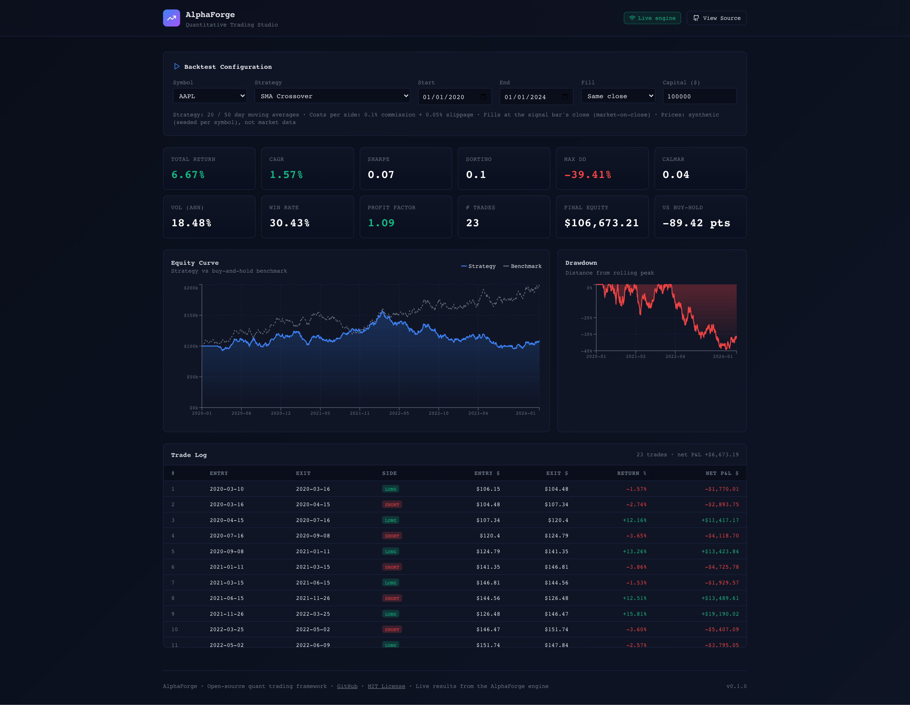

# AlphaForge

[](https://github.com/ROROK20/AlphaForge/actions/workflows/ci.yml)
[](https://python.org)
[](LICENSE)
[](https://github.com/astral-sh/ruff)
[](CONTRIBUTING.md)

**AlphaForge is a Python backtesting framework that keeps itself honest, with ML signals, portfolio optimization and a web dashboard.**

- **The trade log reconciles to the equity curve to the cent.** Every trade's net P&L sums to the curve's P&L, within $0.000001 in process. Proof: `pytest tests/test_backtest.py -k reconcil`
- **ML signals never score a bar they trained on.** On a seeded random walk, where no edge exists, XGBoost reads CAGR -6.78% / Sharpe -0.47 out of sample. Scoring the bars it trained on, the same model read CAGR 118.55% / Sharpe 4.52 ([how each is measured](#xgboost-signal)). Proof: `pytest tests/test_ml_signals.py -k random_walk`
- **Costs and fill timing are shown, not hidden.** Every result states its per-side commission, slippage and fill, and one bar of fill delay [halves the MACD result](#fill-timing--the-biggest-assumption-in-any-backtest). Proof: `pytest tests/test_api.py -k cost_legs`

Run it: `docker compose up --build`, then open http://localhost:3001.

The demo's prices are seeded synthetic data, not market data for the ticker shown. This is research software: not financial advice, and not for trading real money.

**Live demo:** https://alphaforge-two-beta.vercel.app (the engine's recorded default run on a synthetic price feed; run the API for live backtests).

<p align="center">
  
  <br>
  <em>Captured 2026-11-05 by <code>node e2e/smoke.mjs --capture</code> against the live engine API ("Live engine" badge). The prices are the API's seeded synthetic feed, not AAPL market data — and this SMA 20/50 run trails buy-and-hold. <code>docker compose up</code> for the full stack.</em>
</p>

---

## Why Trust the Numbers

Each claim below has a test or command you can run.

- **The trade log sums to the equity curve**, on every signal and cost setting, single- and multi-asset: [`TestReconciliationInvariant`](tests/test_backtest.py), [`TestRunMulti`](tests/test_backtest.py). Over HTTP and in the browser, for every strategy the API exposes: [`node e2e/smoke.mjs`](e2e/smoke.mjs).
- **No signal earns the bar it read**, and no argument can fill it at a price from before that bar: [`test_a_signal_cannot_earn_the_bar_it_was_computed_on`](tests/test_backtest.py), [`TestFillsNeverPrecedeTheSignal`](tests/test_backtest.py).
- **ML signals stay out of sample.** Rewriting the future cannot change a past signal, and a random walk shows no edge: [`test_future_data_cannot_change_past_signals`](tests/test_ml_signals.py), [`test_random_walk_has_no_edge`](tests/test_ml_signals.py).
- **Costs and fills are on the result.** The API echoes commission, slippage and fill, and the dashboard prints them: [`test_both_cost_legs_are_request_options_and_are_echoed`](tests/test_api.py), [`TestFillTiming`](tests/test_backtest.py), [`node e2e/smoke.mjs`](e2e/smoke.mjs).
- **The published figures are the engine's.** The ML figures above run in the suite, and the dashboard's offline recording fails a test if it drifts from the engine: [`test_readme_random_walk_figure_reproduces_as_written`](tests/test_ml_signals.py), [`test_snapshot_is_current_with_the_engine`](tests/test_engine_snapshot.py).

The limits are as plain: shorts pay no borrow cost, cash earns 0%, negative cash is financed free, and there are no margin calls and no market impact. See [What the model leaves out](#what-the-model-leaves-out).

---

## Run the Full Stack

The Next.js dashboard calls a FastAPI backend running the AlphaForge engine. It
re-runs whenever a setting changes, and every run computes an equity curve,
drawdown series, metrics and trade log from `BacktestEngine` and the technical
signals. One command brings up the whole stack:

```bash
docker compose up --build
# Frontend → http://localhost:3001   (Next.js dashboard)
# Backend  → http://localhost:8003   (FastAPI + real engine)
```

or, without Docker:

```bash
make demo-local      # backend on :8003 + frontend dev server on :3001
```

A badge in the header says where the numbers come from. **"Live engine"**: a
`POST /backtest` that just ran. There is no in-browser engine, so with the
backend unreachable the dashboard can only show what the engine already
computed: the default configuration (AAPL, 2020-01-01 → 2024-01-01, $100,000,
0.1% per side, each of the four strategies) has a **"Recorded snapshot"** —
the engine's own response, recorded on the date shown by
`scripts/record_engine_snapshot.py` through the same API handler, trade log
reconciling with the curve. Every other configuration says **"Engine
offline"** and shows no numbers. A static, no-backend deploy therefore shows
that dated recording of the default runs, and nothing else.

```
┌─────────────────────────┐        POST /backtest         ┌──────────────────────────────┐
│  Next.js dashboard       │  ───────────────────────────▶ │  FastAPI  (alphaforge/api/app.py)        │
│  :3001                   │   {symbol, strategy, dates}   │  • BacktestEngine (real)      │
│  EquityChart / Drawdown  │ ◀───────────────────────────  │  • technical Signals          │
│  Statistics / Trades     │   equity · metrics · trades   │  • var_report · Markowitz     │
│  (API down: recorded     │                               │  synthetic-or-supplied OHLCV  │
│   engine output or none) │                               │  :8003                        │
└─────────────────────────┘                               └──────────────────────────────┘
```

Run the API on its own:

```bash
make api                              # → http://localhost:8003
# or:  uvicorn alphaforge.api.app:app --port 8003
curl -s localhost:8003/health
curl -s -X POST localhost:8003/backtest \
  -H 'content-type: application/json' \
  -d '{"symbol":"AAPL","strategy":"sma_crossover","startDate":"2020-01-01","endDate":"2023-01-01","initialCapital":100000,"commission":0.001}'
```

Costs are charged per side on traded notional and are both request fields:
`commission` (default 0.001 = 10 bps) and `slippage` (default 0.0005 = 5 bps),
echoed in every `/backtest` response with the `fill` timing actually used. The
dashboard states both (its slippage is fixed at 0.05%).

Annualised metrics (CAGR, volatility, Sharpe, Sortino, Calmar) use the number of
bars in a year, read from the spacing of the bars: daily 252, weekly 52, monthly
12, quarterly 4, yearly 1. Any other spacing, intraday included, is refused
unless the caller says (`periodsPerYear` in a request, `periods_per_year` on
`BacktestEngine`, `compute_metrics`, `var_report`, `MarkowitzOptimizer` and
`VolatilityParity`). The synthetic feed is business-daily (~261 bars a year), so
a 4-year demo window counts as ~4.14 years — the 252-bar convention, not its
calendar.

Unless you POST your own `ohlcv` bars, the API prices are seeded synthetic
GBM, **not market data for the ticker you name** — every `/backtest`, `/var`
and `/optimize` response says which it used in `dataSource` (`"synthetic"` or
`"supplied"`). Nonsense inputs are rejected with `422`: commission outside
`[0, 0.1]` per side, non-positive, non-finite or above-$1-trillion capital /
portfolio value, an empty `confidenceLevels` or `ohlcv`, a confidence level
under 0.5 (99% is `0.99`, not `0.01`),
symbols longer than 32 characters, non-positive prices, duplicate bar dates,
an `endDate` in the future, fewer than two bars in the window, and `/optimize`
symbol lists with fewer than two distinct tickers (case-insensitive), and any
JSON the endpoint cannot use, a lone `\ud800` surrogate included. Dates are
calendar dates: a timezone offset is dropped to the wall-clock date as written
(`2020-01-01T00:00:00+05:00` is 1 January). The window is exact — the
synthetic feed covers the business days in `[startDate, endDate]` and nothing
more, and supplied bars outside the window are not used (on `/var`, whose
dates have defaults, only when you send a window).

Each endpoint needs enough data for its output to be a statistic, and answers
`422` below it (a window with no business days included): `/backtest` at
least 2 bars, `/var` at least 60 daily returns (61 bars), `/optimize` at least
`max(60, 2 × number of symbols)` daily returns. Undefined ratios come back as
`null`.

**The synthetic path replays from the window's start, so dates select a window
length, not a market period.** A ticker has one fixed path, laid down from each
request's own `startDate` at 100. AAPL 2016-01-01 → 2020-01-01 and
2020-01-01 → 2024-01-01 are the same 1,044 bars under different dates, and
return the same +6.67% in the same 23 trades (`sma_crossover`). A price on a given
date therefore differs between windows: compare strategies within a window, not
across windows. Moving `endDate` only adds or removes bars at the end: every
earlier bar stays as it was, in all five OHLCV columns.

### Deploy

- **Frontend (Vercel):** import the repo, set root to `frontend/`, and set
  `NEXT_PUBLIC_API_URL` to your deployed API URL (and `NEXT_PUBLIC_SITE_URL`
  to the site's own URL, for absolute share-image links; the share image is a
  capture of the recorded snapshot, the state a frontend-only deploy shows). Both are inlined
  into the browser bundle at **build** time — set them before the build
  (Docker: `--build-arg`); changing them on a running server does nothing. A
  production build without `NEXT_PUBLIC_API_URL` calls no API at all: the
  dashboard shows its recorded snapshot. Only `npm run dev` falls back to
  `http://localhost:8003`. A `frontend/vercel.json` is included.
- **Backend (Render / any Docker host):** `render.yaml` builds the root
  `Dockerfile` and serves the API with a `/health` check. On Render the start
  command binds uvicorn to `$PORT`. Any container host works:
  `docker build -t alphaforge-api . && docker run -p 8003:8003 alphaforge-api`.

> Set the frontend's `NEXT_PUBLIC_API_URL` to the backend URL at build time
> (`npm run dev` defaults to `http://localhost:8003`). See `.env.example`.

---

## Table of Contents

- [Why Trust the Numbers](#why-trust-the-numbers)
- [Run the Full Stack](#run-the-full-stack)
- [Features](#features)
- [Architecture](#architecture)
- [Installation](#installation)
- [Quick Start](#quick-start)
- [Web Demo / Frontend](#web-demo--frontend)
- [CLI Usage](#cli-usage)
- [Backtesting Walkthrough](#backtesting-walkthrough)
- [ML Signals](#ml-signals)
- [Risk Management](#risk-management)
- [Portfolio Optimization](#portfolio-optimization)
- [Writing a Custom Strategy](#writing-a-custom-strategy)
- [Testing](#testing)
- [Project Structure](#project-structure)
- [Roadmap](#roadmap)
- [Contributing](#contributing)
- [Security](#security)
- [Code of Conduct](#code-of-conduct)
- [Changelog](#changelog)
- [License](#license)

---

## Features

- **Vectorized backtesting** — pandas-native engine: positions, costs and the equity curve are array operations (a 5-year daily backtest runs in ~5 ms — [measured](docs/architecture.md#performance)); positions are shares held from entry; equity floors at $0 (a ruined account stops trading)
- **ML signal generation** — XGBoost classifier and LSTM price predictor that never score a bar they trained on: an unfitted `generate()` runs a purged expanding walk-forward
- **Technical signals** — SMA crossover, RSI and Bollinger Band mean reversion, MACD regime, and weighted ensembles of any signals
- **Risk tools** — Kelly Criterion, Fixed Fractional and Volatility Parity sizers, and a `DrawdownMonitor` that reports when a drawdown or daily-loss limit is breached. These are standalone: the engine, the strategies, the CLI and the API call none of them, so you apply them in your own code ([how](#position-sizing))
- **VaR suite** — Parametric, Historical Simulation, and Monte Carlo VaR/CVaR at any confidence level
- **Portfolio optimization** — Markowitz mean-variance: max Sharpe, min volatility, risk parity, max diversification
- **Alpaca Paper-Order Client** — `PaperTrader` submits, lists and closes orders by hand on Alpaca's paper endpoint. It is not a trading loop: nothing connects a signal to an order. It has only run against a fake client in the tests, never the real SDK ([SECURITY.md](SECURITY.md))
- **CLI** — Terminal reports with equity curves and metrics tables

---

## Architecture

```
┌──────────────────────────────────────────────────────────────┐
│                         CLI / API                            │
│              alphaforge backtest / optimize / var            │
└──────┬──────────────────┬────────────────────┬───────────────┘
       │ backtest         │ var                │ optimize
┌──────▼──────────┐ ┌─────▼─────────┐ ┌────────▼──────────────┐
│ BacktestEngine  │ │   VaR Suite   │ │    Optimization       │
│ Vectorized P&L  │ │ Parametric    │ │  max_sharpe           │
│ Trade Log       │ │ Historical    │ │  min_vol              │
│ signal t never  │ │ Monte Carlo   │ │  risk_parity          │
│ earns bar t     │ └───────────────┘ └───────────────────────┘
└──────▲──────────┘
       │ target positions
┌──────┴──────────┐   Standalone, called by your own code:
│    Signals      │   position sizers, DrawdownMonitor
│  Technical      │
│  ML (XGB, LSTM) │
│  Ensemble       │
└──────▲──────────┘
       │ OHLCV
┌──────┴────────────────────────────────────────────────────────┐
│                        Data Layer                             │
│   yfinance + Alpha Vantage · Disk Cache · Feature Engineering │
│   (the API uses seeded synthetic or caller-supplied bars)     │
└───────────────────────────────────────────────────────────────┘
```

---

## Installation

```bash
git clone https://github.com/ROROK20/AlphaForge.git
cd AlphaForge
pip install -e .

# Optional: ML (PyTorch LSTM)
pip install -e ".[torch]"

# Optional: Alpaca paper-order client
pip install -e ".[live]"
```

**macOS:** run `brew install libomp` first. XGBoost's macOS wheels load the OpenMP
runtime from Homebrew and do not ship it, so without it the first XGBoost model
fails with `XGBoost Library (libxgboost.dylib) could not be loaded` (checked
2026-11-09 on the xgboost 3.2.0 and 3.4.1 wheels for Apple silicon).

---

## Quick Start

```python
from alphaforge import DataFetcher, BacktestEngine
from alphaforge.signals.technical import SMACrossoverSignal

# 1. Fetch data
df = DataFetcher().fetch_ohlcv("AAPL", "2020-01-01", "2023-12-31")

# 2. Define signal
signal = SMACrossoverSignal(fast=20, slow=50)

# 3. Run backtest
result = BacktestEngine(initial_capital=100_000).run(signal, df)

# 4. Inspect results
print(result)
# Output of a real run, re-derived 2026-11-03 on yfinance data fetched
# 2026-07-29 (read back from the local cache, ~/.alphaforge/cache):
# BacktestResult(cagr=-3.05%, sharpe=-0.02, max_drawdown=-56.06%, trades=22)
# (Long/short 20/50 crossover, default costs. It lost money on AAPL over this
#  window — the example shows the API, not a recommended strategy. yfinance
#  back-adjusts history on every dividend, so re-runs drift slightly.)
```

> See [docs/usage.md](docs/usage.md) for an end-to-end guide and
> [docs/architecture.md](docs/architecture.md) for the system design.

---

## Web Demo / Frontend

An interactive **Next.js 15** dashboard for exploring backtests in the browser —
pick a symbol, strategy, and date range and watch equity curves, drawdown
charts, and a trade log update live. Every run is computed by the engine API
(start it with `make api`, or use `make demo-local` / `docker compose up` for
both); its prices are synthetic, so **no API keys or market data** are needed.
Without the API the dashboard shows only the recorded engine snapshot of the
default configuration (see [Run the Full Stack](#run-the-full-stack)).

```bash
cd frontend
npm install
npm run dev
# → open http://localhost:3001
```

Build it for production with:

```bash
cd frontend
# NEXT_PUBLIC_API_URL is baked in at build time; without it the production
# build calls no API and shows only the recorded snapshot.
NEXT_PUBLIC_API_URL=http://localhost:8003 npm run build && npm start   # http://localhost:3001
```

Requires **Node 18+**.

---

## CLI Usage

```bash
# Backtest SMA crossover on Apple
alphaforge backtest --strategy sma_crossover --symbol AAPL --start 2020-01-01 --end 2023-12-31

# Output of a real run, re-derived 2026-11-03 on yfinance data fetched
# 2026-07-29 (read back from the local cache, ~/.alphaforge/cache; long/short,
# 10 bps commission + 5 bps slippage per side; panel trimmed):
# ╭──────────────────────────────────────────────────────────────────────────────╮
# │ Backtest Results — AAPL | Sma Crossover                                      │
# │ 2020-01-01 → 2023-12-31 | Capital: $100,000                                  │
# │ Costs per side: 0.10% commission + 0.05% slippage | Fill: signal-bar close   │
# │ (market-on-close)                                                            │
# ╰──────────────────────────────────────────────────────────────────────────────╯
# ╭─────────────────┬──────────╮
# │ Metric          │    Value │
# ├─────────────────┼──────────┤
# │ Total Return    │  -11.61% │
# │ CAGR            │   -3.05% │
# │ Sharpe Ratio    │    -0.02 │
# │ Sortino Ratio   │    -0.03 │
# │ Calmar Ratio    │    -0.05 │
# │ Max Drawdown    │  -56.06% │
# │ Max DD Duration │ 837 bars │
# │ Annualized Vol  │   29.93% │
# │ Win Rate        │   40.91% │
# │ Profit Factor   │     0.90 │
# │ # Trades        │       22 │
# ╰─────────────────┴──────────╯
# (A 20/50 crossover that also goes short lost money on AAPL over this window;
#  the example shows the report, not a recommended strategy. Win rate and
#  profit factor are on net dollar P&L, so PF < 1 exactly when the run lost
#  money. A FRESH fetch drifts slightly: yfinance back-adjusts history on
#  every dividend.)

# Portfolio optimization across multiple assets. Only the dates every ticker
# has a price on are used, and the command prints that window first.
alphaforge optimize --symbols AAPL,MSFT,GOOGL,AMZN --objective max_sharpe

# VaR report
alphaforge var --symbol SPY --capital 1000000
```

---

## Backtesting Walkthrough

### Single asset — technical signal

```python
from alphaforge.data.fetcher import DataFetcher
from alphaforge.signals.technical import RSIMeanReversionSignal, MACDSignal
from alphaforge.signals.ensemble import EnsembleSignal
from alphaforge.backtest.engine import BacktestEngine

df = DataFetcher().fetch_ohlcv("TSLA", "2020-01-01", "2023-12-31")

# Ensemble: RSI + MACD with weights
ensemble = EnsembleSignal(
    signals=[RSIMeanReversionSignal(), MACDSignal()],
    weights=[0.5, 0.5],
)

result = BacktestEngine(
    initial_capital=100_000,
    commission=0.001,
    long_only=True,
).run(ensemble, df)

print(f"Sharpe: {result.metrics['sharpe']:.2f}")
print(f"CAGR: {result.metrics['cagr']:.2%}")
print(f"Max Drawdown: {result.metrics['max_drawdown']:.2%}")
print(result.trades.head())
```

### Fill timing — the biggest assumption in any backtest

No signal ever earns the bar it was computed on: a signal from bar *t*'s close
is held from bar *t + 1*. But by default it is **filled at bar *t*'s own close**
(market-on-close), which is optimistic for a signal that needs that close to be
computed — in practice the order fills a bar later. Pass
`BacktestEngine(fill="next_close")` (API `"fill": "next_close"`, CLI
`--fill next_close`, the dashboard's **Fill** selector) to fill one bar after
the signal.

The default is `"close"` because it is the plain vectorized-backtest assumption
and what a market-on-close order gets, if the signal can be computed just before
the auction. What that costs is in the table: it trades on a close before that
close is final, and it reports MACD at Sharpe 0.48 where one bar of delay gives
0.30. Every backtest figure in this README uses the default unless it says
otherwise; `next_close` is the fill you could place after seeing the close.
Re-derived 2026-11-03 on the same AAPL 2020-01-01 → 2023-12-31 yfinance data as
the Quick Start (default costs, long/short):

| Signal | `fill="close"` (default) | `fill="next_close"` |
|---|---|---|
| SMA 20/50 crossover | −11.61% (Sharpe −0.02) | +2.40% (Sharpe 0.10) |
| RSI(14) 30/70 reversion | −16.20% (Sharpe −0.32) | −28.78% (Sharpe −0.59) |
| MACD 12/26/9 regime | +58.56% (Sharpe 0.48) | +29.97% (Sharpe 0.30) |
| Bollinger (20, 2σ) reversion | −28.16% (Sharpe −0.26) | −39.80% (Sharpe −0.43) |

One bar of fill delay halves the MACD result and lowers RSI and Bollinger, yet
turns the SMA loss into a gain, so the delay can move a result either way. Read
any single-fill figure as one estimate, not a bound: run both.

The fill is always a close. `run(signal, df, price_col=...)` takes `"Close"` or
`"Adj Close"` and refuses anything else: `price_col="Open"` would fill a signal
computed at a bar's close at that same bar's open, earning the move it had just
read (Sharpe 17.03 for `sign(close change)` on the demo feed's random walk, AAPL
2020-01-01 → 2024-01-01).

Trade-log dates follow the fills: `entry_date` and `exit_date` are the bars
whose closes are `entry_price` and `exit_price` (± slippage), under either
`fill` mode. A position still open on the last bar, or ruined, is marked at
that bar's bare close with no slippage, since no exit was charged.

### What the model leaves out

- **Shorts pay no borrow cost.** A short pays commission and slippage like any
  trade and nothing else: no stock-loan fee, however long it is held. This
  flatters any strategy that shorts, as every signal above does by default.
- **Cash earns 0%.** Idle cash and short-sale proceeds earn no interest, which
  understates a strategy that spends time flat.
- **Negative cash is financed free.** A signal bounds a position when it is
  entered, and nothing rebalances it afterwards. `run_multi` sizes each leg from
  the whole book's equity while the legs it already holds have drifted, so the
  book can pass 1x gross and borrow, at no charge. With the README's weights below,
  long-only SMA 20/50 on the demo feed 2015-01-01 → 2024-01-01 reaches 1.19x gross,
  and cash is negative on 203 of 2,348 bars, as low as −$27,155 (re-derived
  2026-11-04). This flatters any book that does it.
- **Sharpe and Sortino subtract a fixed 2% a year** (`RISK_FREE_RATE` in
  `alphaforge/backtest/metrics.py`, 2% / 252 per bar), whatever rates were over
  the window; no run can set it. CAGR and Calmar do not use it.
  `MarkowitzOptimizer` starts from the same 2%, as its `risk_free_rate`
  argument.
- **No margin calls and no market impact.** Nothing closes or trims a position
  that has outgrown its account until equity reaches $0 (ruin), and any size fills
  at the close for the same slippage. With no costs, a short through a +99.9% bar
  is left with 0.1% of its capital, still holding the whole position at 1,999x
  gross, not ruined (re-derived 2026-11-04). This flatters anything that survives
  such a move and anything trading size.

### Inputs the engine refuses

`BacktestEngine` raises `ValueError` (the CLI
prints it and exits 1) on a negative or non-finite cost, capital that is not
finite and positive, bars out of time order (sort a newest-first CSV first),
duplicate dates, a NaN, infinite, zero or negative price, a `price_col` that is
not a close, and bars whose spacing does not say how many make a year (intraday,
say) unless `periods_per_year` does. `run_multi` also
refuses a signal that does not line up with the prices, assets that share no
dates, and a negative weight under `long_only`. `MarkowitzOptimizer` needs at
least `max(60, 2 × assets)` returns, the same floor as `/optimize`, and refuses
`max_sharpe` when no portfolio it may hold beats the risk-free rate ([why](#portfolio-optimization));
`alphaforge var` needs at least 60, the same as `/var`. On the CLI an unparseable
`--start` or `--end` is a usage error, and `alphaforge optimize` refuses a ticker
with no data rather than optimizing the others, and prints the window the
tickers share, naming any ticker whose history cut it short.

### Multi-asset backtest

```python
from alphaforge.backtest.engine import BacktestEngine
from alphaforge.data.fetcher import DataFetcher
from alphaforge.signals.technical import SMACrossoverSignal

symbols = ["AAPL", "MSFT", "GOOGL", "AMZN"]
fetcher = DataFetcher()

data_map = {sym: fetcher.fetch_ohlcv(sym, "2020-01-01", "2023-12-31") for sym in symbols}
# run_multi takes symbol -> signal *series* (call .generate())
signals_map = {sym: SMACrossoverSignal(fast=20, slow=50).generate(data_map[sym]) for sym in symbols}

result = BacktestEngine().run_multi(
    signals_map, data_map,
    weights={"AAPL": 0.3, "MSFT": 0.3, "GOOGL": 0.2, "AMZN": 0.2}
)
```

---

## ML Signals

### XGBoost Signal

Trains a gradient-boosted classifier on lagged price/volume features to predict 5-day direction.

**Out-of-sample by construction.** `generate()` never scores a bar the model
was trained on. Unfitted, it runs a *purged expanding walk-forward*: it
retrains every `retrain_every` bars (default 63) on all earlier history,
dropping the last `target_horizon` rows before each block so no label reaches
into it, and keeps bars flat until `min_train_size` (default 252) labelled
rows exist. After an explicit `fit(train)`, it scores only bars after
`train`'s last bar. On the demo API's synthetic feed — a seeded random walk
with drift, so no strategy has an edge — this exact call:

```python
from alphaforge import BacktestEngine
from alphaforge.api.app import synthetic_ohlcv
from alphaforge.signals.ml_signals import XGBoostSignal

df = synthetic_ohlcv("AAPL", "2015-01-01", "2024-01-01")   # 2,348 bars
m = BacktestEngine().run(XGBoostSignal(n_estimators=200), df).metrics
print(f"CAGR {m['cagr']:.2%} / Sharpe {m['sharpe']:.2f}")
# CAGR -6.78% / Sharpe -0.47   (purged walk-forward)
```

is what `generate()` reports. Train on `df` and score `df` itself, the leak this
contract rules out, and the same model on these same bars read **CAGR 118.55% /
Sharpe 4.52** (measured 2026-11-03 on the engine of that date). With the guard
switched off by hand, the engine in this repository reads **CAGR 117.99% / Sharpe 4.55**
(measured 2026-11-04):

```python
import pandas as pd

leaky = XGBoostSignal(n_estimators=200).fit(df)
leaky.trained_through_ = df.index[0] - pd.Timedelta(days=1)   # switches off the guard
m = BacktestEngine().run(leaky, df).metrics
```

The out-of-sample figure was re-derived 2026-11-03 with xgboost 3.2.0 (the version
pinned in `requirements.txt`) on macOS arm64; it is identical at 1, 4 and 8 threads
and unpinned. The trees — so the exact figure — depend on the xgboost release:
3.4.1, which `pip` resolves on Python 3.12 today, prints CAGR -8.23% / Sharpe -0.57
for the same call (numpy and scipy versions make no difference). Either way, no
edge. `tests/test_ml_signals.py` runs both calls: it checks the printed digits under
xgboost 3.2.0 on macOS arm64, and everywhere else that the out-of-sample result stays
a no-edge result (Sharpe below 0.5, CAGR below 0), nowhere near the leak's.

```python
from alphaforge.signals.ml_signals import XGBoostSignal
from alphaforge.data.preprocessor import add_technical_features, create_lagged_features

df = DataFetcher().fetch_ohlcv("AAPL", "2018-01-01", "2023-12-31")
df = add_technical_features(df)
df = create_lagged_features(df, n_lags=5)
df = df.dropna()

# Strict train/test split (no look-ahead)
train, test = df.iloc[:int(len(df)*0.7)], df.iloc[int(len(df)*0.7):]

signal = XGBoostSignal(target_horizon=5)
signal.fit(train)
# Score the full history so test bars get warmed-up features; every bar up
# to train's last bar comes back flat, so only test bars are scored.
signals = signal.generate(df).loc[test.index]

result = BacktestEngine().run(signals, test)

# Zero-config alternative: purged walk-forward over the whole series
wf_signals = XGBoostSignal(target_horizon=5).generate(df)
```

### LSTM Signal

Two-layer LSTM for sequence-based price prediction. Same out-of-sample
contract; pass `random_state` for reproducible training.

```python
from alphaforge.signals.ml_signals import LSTMSignal

signal = LSTMSignal(hidden_size=64, num_layers=2, seq_len=20, epochs=50, random_state=0)
signal.fit(train)
signals = signal.generate(df).loc[test.index]
```

### XGBoost and LSTM in one process

On macOS, with both `xgboost` and `torch` installed, `XGBoostSignal` and
`LSTMSignal` fit and score on one thread each. xgboost and torch each bring their
own OpenMP runtime, and at their default thread counts one script running both
deadlocks or segfaults (measured 2026-11-04 on macOS arm64, xgboost 3.2.0, torch
2.13.0: XGBoost then LSTM never finished; LSTM then XGBoost segfaulted). One
thread starts no worker pool. The limit applies only inside these two classes,
restores torch's thread count on return, and sets no environment variable; other
platforms keep their default thread counts.

If your own code also calls xgboost or torch in that process and it hangs or
crashes, start Python with `OMP_NUM_THREADS=1`, or run the two models in separate
processes.

### Walk-Forward Validation

```python
from strategies.ml_momentum import MLMomentumStrategy

strategy = MLMomentumStrategy(target_horizon=5, train_ratio=0.6)
result = strategy.run_walk_forward(
    "AAPL", "2018-01-01", "2023-12-31",
    window_size=252,  # 1 year training
    step_size=63,     # quarterly retraining
)
print(f"OOS Sharpe: {result.metrics['sharpe']:.2f}")
```

---

## Risk Management

### Position Sizing

A sizer returns a fraction of capital for your own code to use. The engine has no
sizer argument, and nothing in the engine, the strategies, the CLI or the API calls
one. To backtest a sizer's output, multiply a signal by it and pass the series, since
the engine takes fractional target positions:
`BacktestEngine().run(signal.generate(df) * kelly.size(100_000), df)`.

```python
from alphaforge.risk.position_sizing import KellyCriterion, FixedFractional, VolatilityParity

# Quarter-Kelly from historical win stats. Full Kelly = p - q/b with
# b = avg_win/avg_loss = 1.5: 0.58 - 0.42/1.5 = 30%; a quarter of that is 7.5%.
kelly = KellyCriterion(win_rate=0.58, avg_win=0.045, avg_loss=0.030, fraction=0.25)
print(f"Kelly position size: {kelly.size(100_000):.1%}")  # 7.5%

# Risk 2% per trade with 5% stop-loss: 0.02 / 0.05 = 40% of capital
ff = FixedFractional(risk_per_trade=0.02)
print(f"Fixed fractional: {ff.size(100_000, stop_distance=0.05):.1%}")  # 40.0%
```

### Drawdown Monitor

`DrawdownMonitor` reports a breach to the code that calls it: `update()` returns False
and sets `halt_reason`. No backtest consults it, so the only thing that stops a
`BacktestEngine` run is ruin.

```python
from alphaforge.risk.drawdown import DrawdownMonitor

monitor = DrawdownMonitor(max_drawdown_pct=-0.15, daily_loss_limit=-0.03)

# Called each trading day
if not monitor.update(portfolio_value, daily_return):
    print(f"Trading halted: {monitor.halt_reason}")
    # DrawdownMonitor only reports the halt: closing positions is up to your code.
```

### VaR Report

```python
from alphaforge.risk.var import var_report

returns = df["Close"].pct_change().dropna()   # df from the Quick Start
report = var_report(returns, portfolio_value=1_000_000)
print(report.round(0).to_string())
# Real output, 2026-11-01 (AAPL 2020-2023 via yfinance; dollars of loss):
#             param_var_1d  hist_var_1d  param_var_10d  hist_var_10d  param_cvar_1d
# confidence
# 90%              25913.0      22912.0        73831.0       72454.0        35924.0
# 95%              33595.0      32406.0        98125.0      102476.0        42431.0
# 99%              48006.0      55592.0       143696.0      175798.0        55172.0
```

---

## Portfolio Optimization

**The weights are in-sample.** They are fitted to the returns you pass, and
`expected_return`, `volatility` and `sharpe` are measured on those same returns:
they describe that window and forecast nothing. `POST /optimize` says so in its
`note`, and adds a `warning` when one asset takes about 100% (at least 99%), as
`alphaforge optimize` also prints: GOOGL and XOM on the synthetic feed
2024-01-01 → 2024-04-01 is 100% GOOGL at an expected return of +84.05% and Sharpe
4.41, fitted to one quarter's sample (re-derived 2026-11-09).

**`max_sharpe` needs a portfolio that beats the risk-free rate.** When no portfolio
within the weight limits does, every Sharpe ratio is negative and the largest
belongs to the most volatile portfolio, so the objective is refused rather than
answered: `ValueError` from `MarkowitzOptimizer`, exit 1 from `alphaforge
optimize`, `400` from `POST /optimize`. TSLA and XOM over that same quarter both
lose money (the best a long-only book can expect is XOM's −49.21% a year), so
`max_sharpe` is refused there, and `min_volatility` answers 52.09% TSLA / 47.91%
XOM. With `allow_short=True` the test is on the best long/short book, not on
each asset.

```python
import pandas as pd
from alphaforge.optimization.markowitz import MarkowitzOptimizer

prices = {sym: df["Close"] for sym, df in data_map.items()}
returns = pd.DataFrame(prices).pct_change().dropna()

opt = MarkowitzOptimizer(returns)

# Maximum Sharpe ratio
max_sharpe = opt.optimize("max_sharpe")
print(max_sharpe.weights)

# Efficient frontier
frontier = opt.efficient_frontier(n_points=100)
print(frontier[["expected_return", "volatility", "sharpe"]])
```

---

## Writing a Custom Strategy

```python
from alphaforge.signals.base import Signal
import pandas as pd
import numpy as np


class MomentumBreakoutSignal(Signal):
    """Long from a close above the prior N-day high until a close below the
    prior N-day low (a Donchian-channel breakout that HOLDS the position)."""

    name = "Momentum Breakout"

    def __init__(self, window: int = 20) -> None:
        self.window = window

    def generate(self, df: pd.DataFrame) -> pd.Series:
        self._validate_df(df)
        prior = df["Close"].shift(1)
        signals = pd.Series(np.nan, index=df.index)          # NaN = no change
        signals[df["Close"] > prior.rolling(self.window).max()] = 1
        signals[df["Close"] < prior.rolling(self.window).min()] = 0
        return self._fill_signals(signals, df.index)         # hold between events


# Use it (df from the Quick Start)
signal = MomentumBreakoutSignal(window=20)
result = BacktestEngine().run(signal, df)
print(result)
# Output of a real run, 2026-11-03, on the Quick Start's cached AAPL data:
# BacktestResult(cagr=15.34%, sharpe=0.67, max_drawdown=-25.86%, trades=15)
# (A signal is a POSITION: one that is 1 only on the breakout bar trades a
#  one-bar pulse -- 91 trades with a median hold of 2 bars on the same data.)
```

---

## Testing

```bash
# Run all tests
pytest tests/ -v

# With coverage
pytest tests/ --cov=alphaforge --cov-report=html

# Specific module
pytest tests/test_backtest.py -v
```

Expected output:
```
tests/test_backtest.py::TestBacktestEngine::test_returns_backtest_result PASSED
tests/test_backtest.py::TestBacktestEngine::test_equity_curve_length PASSED
tests/test_metrics.py::TestSharpRatio::test_sharpe_known_value PASSED
...
724 passed
```
<sub>Count verified 2026-11-09 (Python 3.12). Needs `pip install -e ".[dev,torch]"` — with
`.[dev]` alone the fifteen tests that need torch skip (it is its own extra), giving
709 passed / 15 skipped.</sub>

### Live-fire smoke test

One command boots the real API and the real dashboard, drives both, and tears
them down. It asserts the **reconciliation invariant** — the trade log's summed
net P&L equals the equity curve's P&L, with a hard bound of 0.1% of initial
capital — over HTTP for every strategy the API exposes, checks that
the seeded engine output is reproducible, confirms the dashboard renders those
same live numbers, and requires zero browser console errors.

```bash
node e2e/smoke.mjs
```

In process the two totals match to float precision (the suite pins it at
1e-6). Over HTTP and on screen every figure is rounded to the cent, so a sum of
rows can differ by up to half a cent per row: the default SMA run's trade log
adds up to $6,673.19 against an equity gain of $6,673.21, and the driver's bound
allows for exactly that.

Exit 0 means every assertion passed. It needs ports 8003 + 3001 free — it refuses
to run against an already-listening server rather than report a false pass — and
Playwright with its browser, once, in `frontend/` (`npm install` fetches
Playwright, a devDependency there, but not the browser it drives):

```bash
cd frontend && npm install && npx playwright install chromium
```

---

## Project Structure

```
alphaforge/
├── alphaforge/
│   ├── api/            # FastAPI layer over the engine
│   ├── data/           # Data fetching, preprocessing, universe management
│   ├── signals/        # Technical + ML signals, ensemble combination
│   ├── backtest/       # Vectorized engine, metrics, portfolio tracking
│   ├── risk/           # Position sizing, drawdown control, VaR
│   ├── optimization/   # Markowitz mean-variance optimizer
│   ├── live/           # Alpaca paper-order client
│   └── cli.py          # Rich terminal CLI
├── strategies/         # Pre-built composable strategies
├── frontend/           # Next.js 15 web demo (port 3001)
├── tests/              # Pytest test suite (count + method under Testing)
└── docs/               # Architecture + usage documentation
```

---

## Roadmap

- [ ] Options pricing (Black-Scholes, Heston)
- [ ] Cryptocurrency data source (CCXT)
- [ ] Transformer-based signal (attention on price sequences)
- [ ] Real-time streaming backtesting
- [ ] Interactive Plotly dashboard
- [ ] Factor model integration (Fama-French)

---

## Contributing

Contributions are welcome! Please read the
**[Contributing Guide](CONTRIBUTING.md)** for setup instructions, the test/lint
workflow, code style, and our [Conventional Commits](https://www.conventionalcommits.org/)
convention.

Quick version:

1. Fork the repo and create a feature branch (`git checkout -b feat/new-signal`)
2. `pip install -e ".[dev]"` and add tests for your changes
3. Ensure `pytest tests/` and `ruff check` pass
4. Open a pull request using the [PR template](.github/PULL_REQUEST_TEMPLATE.md)

For major changes, please [open an issue](https://github.com/ROROK20/AlphaForge/issues) first.

---

## Security

Found a vulnerability? **Please do not open a public issue.** See our
**[Security Policy](SECURITY.md)** and report it privately to
[rohan.s.khiani.vora@gmail.com](mailto:rohan.s.khiani.vora@gmail.com).

---

## Code of Conduct

This project follows the [Contributor Covenant](CODE_OF_CONDUCT.md). By
participating, you are expected to uphold it.

---

## Changelog

See [CHANGELOG.md](CHANGELOG.md) for what each release ships and its known limits.

---

## License

Released under the [MIT License](LICENSE).

MIT © 2026 [Rohan Khiani](https://github.com/ROROK20)